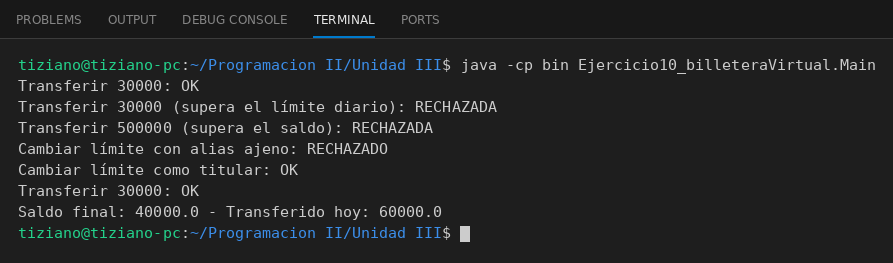

# BilleteraVirtual

Programación II - Unidad 3 - Ejercicio 10

## Consigna
Modelar la clase aplicando encapsulamiento: atributos privados y métodos públicos que validan antes de modificar el estado. Una billetera virtual con límite diario de transferencia.

## Lógica
- `transferir(monto)` verifica a la vez que el monto no supere el saldo y que no se rebase el límite diario.
- Acumula lo transferido en el día.
- `configurarLimite(alias, nuevoLimite)` exige el alias del titular y un valor positivo.
- `Main` prueba transferencias exitosas y rechazadas.

## Ejecución

